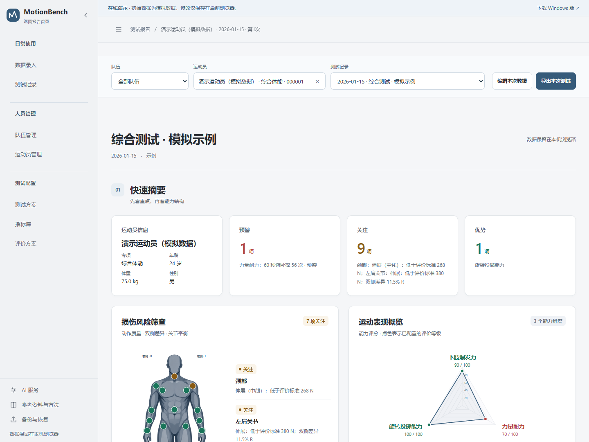

# MotionBench

运动表现评估与训练报告工作台，用于组织测试、录入测量、管理运动员、分析能力结构并输出教练报告。支持 Windows 桌面程序和离线单文件 HTML，两版共用计算、评价和报告界面。

**当前版本：Windows `2.26.4-desktop.1` · HTML `2.26.4`。**

2.26.4 恢复 mini 图原有的 125px 绘图区宽度；刻度留白扩展外框，同份报告保持统一大小，底色和半透明样式保持原样。

2.26.2 统一三种报告的墨青配色：历史日期由青经蓝至靛区分，最近测试日突出；横向比较收窄指标列，并将报告重点与比较基准移至标题上方。

2.25.0 新增横向比较报告、专项细分和年龄段管理。[2.24.13 回退版本](https://github.com/ZekeNiu/MotionBench/releases/tag/v2.24.13-desktop.1)继续保留。回退时同时恢复升级前的资料备份。

2.25.2 调整报告雷达图的大小与留白：比较报告的风险与能力图使用一致高度，多维图形收紧半径；等长力量有 10 个部位时保留完整雷达图。

[在线 Demo](https://zekeniu.github.io/MotionBench/) · [安装版 2.26.4](https://github.com/ZekeNiu/MotionBench/releases/download/v2.26.4-desktop.1/MotionBench-2.26.4-desktop.1-Setup-x64.exe) · [便携版 2.26.4](https://github.com/ZekeNiu/MotionBench/releases/download/v2.26.4-desktop.1/MotionBench-2.26.4-desktop.1-Portable-x64.exe) · [离线 HTML 2.26.4](https://github.com/ZekeNiu/MotionBench/releases/download/v2.26.4-desktop.1/MotionBench.html)

同一运动员的纵向比较直接从首页开始：勾选多条测试记录，每张图可独立选择展示日期；结果表统一显示一列“变化趋势”，mini 图展示全部所选日期，并带纵轴刻度与单位。悬停、键盘或触屏可查看具体读数与相邻变化。损伤风险筛查使用部位雷达，运动表现概览少于3维用表格、3维及以上用雷达。

首页采用“选择运动员 → 测试记录 → 查看报告”的紧凑折叠流程，选好后统一应用；群体参照位于运动员选择内，通过独立弹窗配置，支持最近可比测试、期间最佳和期间均值，群体先汇总数值再评价。专项分类与年龄分组进入独立管理页。已保存报告位于“测试记录”页面。详见 [2.26.2 使用说明](docs/motionbench-2.26.2.md)。构建、桌面安装与资料保护的验证见 [2.26.4 验收记录](docs/acceptance-2.26.4.md)。



## 选择使用方式

| 版本 | 适合场景 | 打开方式 | 资料位置 |
| --- | --- | --- | --- |
| Windows 安装版 | 日常测试与报告，推荐 | 运行 Setup，选择目录，打开快捷方式 | 当前 Windows 用户的本机资料目录 |
| Windows 便携版 | 无需安装，直接运行 | 运行 Portable exe | 与安装版共用当前 Windows 用户的本机资料目录 |
| 离线 HTML | 浏览器使用、跨平台或分享单条报告 | 下载 HTML；本机 AI 中转可使用 HTML ZIP 内的启动器 | 对应浏览器、来源及页面路径的本地资料库 |
| 在线 Demo | 快速体验完整工作台 | [直接打开](https://zekeniu.github.io/MotionBench/) | 当前浏览器的 Demo 资料库 |

在线 Demo 只包含专门生成的模拟运动员和测量，不包含真实人员资料。录入和修改保存在当前浏览器，不会成为其他访客的示例。Demo 与桌面版分别存储资料，需要交换时使用完整备份。部署方式与隐私检查见 [Demo 说明](docs/demo.md)。

## 从测试到报告

1. **建立档案**：管理运动员与队伍，记录专项、性别、生日和训练背景。
2. **设置测试**：选择一人或多人、测试日期、项目和共用评价方案；测试方案可重复使用。
3. **录入测量**：逐项填写或下载 Excel 模板，完成后导入并核对。已有测量可选择保留或替换，空白项不会清除已测数据。
4. **查看分析**：快速摘要、损伤风险筛查、运动表现概览、能力结构和具体数据使用同一套结果；选择多条记录查看纵向比较，重复试次保留原始数据与统计。
5. **完成报告**：编辑解读，生成离线摘要或 AI 综合建议，导出 PDF、独立 HTML、单条 JSON 或完整 JSONL 备份。

## 主要功能

| 范围 | 支持内容 |
| --- | --- |
| 损伤风险筛查 | FMS、等长力量、双侧差异、关节平衡、疼痛与部位结果 |
| 跳跃与爆发力 | CMJ、SJ、DJ、10/5 Hop、CMRJ、IMTP、重复试次统计 |
| 负荷与力量速度 | 负荷－速度、SJ/CMJ 跳跃 FVP、冲刺 FVP、弹性分析和表现响应 |
| 速度与心肺 | MAS、MSS、30–15 VIFT、速度耐力、乳酸、CPET 摄氧量与阈值 |
| 评价体系 | 项目及能力目录、可复用方案、参考目标、分级区间、单位与协议匹配 |
| 通用项目图表 | 六种图型、指标选择与排序、项目统一配置、已有兼容报告同步、导出图样保留 |
| 纵向比较 | 多记录勾选、统一评价依据、日期图层、全部所选日期的变化趋势、逐期完整分析与评价、独立解读及完整导出 |
| 横向比较 | 个人主角或多人并列、全库/专项/队伍参照、性别/细分/测试年龄筛选、每人等权统计、来源明细、独立正文和冻结快照 |
| 人员和记录 | 队伍、搜索、批量操作、历史记录、归档、回收站和测试方案 |
| 数据与交付 | Excel 模板及导入、JSON/JSONL 备份与恢复、独立 HTML、PDF |
| 解读 | 可编辑人工正文、离线规则摘要、AI 草稿预览与应用、历史正文保留 |

最佳试次与均值可切换；至少三个有效值显示均值、样本 SD 与适用时的 CV。缺测保留为空。Hop 以整次测试结果呈现，历史逐跳资料继续保留。

评价方案更新后，关联记录使用最新标准，原始测量和人工解读保留。协议、单位和测量条件影响标准匹配，评价结果与报告共用同一计算入口。EUR 使用未舍入的 CMJ/SJ 比值：**大于 1.1 强调向心能力，小于或等于 1.1 强调利用 SSC 的能力**。

## Windows 安装与更新

适用于 Windows 10 / 11 x64。Setup 包含完整 Electron 运行环境，安装向导可选择中文、含空格及非系统盘目录。Portable 首次启动会解包运行环境。

- **本轮 2.25.2 升级**：使用 `MotionBench-2.25.2-desktop.1-Setup-x64.exe`。实际升级与资料核对的完成状态见 [2.25.2 验收记录](docs/acceptance-2.25.2.md)。
- **公开版本升级**：在侧栏底部“应用设置”检查、下载并重启更新，或运行公开发行的 Setup。
- **安装版更新**：沿用原安装目录。启动检查默认开启，可关闭；下载和安装均需点击，普通退出不会自动安装。
- **便携版更新**：在应用设置检查并打开便携版下载，退出程序后替换 exe。
- **资料保存**：安装版和便携版共用 `%APPDATA%\MotionBench Desktop`，与程序目录分开。升级、重装及卸载保留资料。

桌面版本后缀 `desktop.1` 标识专用发行通道。完整发行资产包含 Setup、Portable、desktop.yml、安装包 blockmap、校验值与构建来源。当前 exe 未配置数字签名，可用发行附件 `SHA256SUMS.txt` 核对下载文件。

操作详情见 [桌面版使用说明](docs/windows-desktop.md)。

## HTML、本机入口与资料迁移

下载[2.25.2 版本页](https://github.com/ZekeNiu/MotionBench/releases/tag/v2.25.2-desktop.1)中的 `MotionBench.html` 即可直接打开，无需安装。需要本机 AI 中转时，可使用同版本源码包中的启动器：Windows 运行 `Start_MotionBench.cmd`；其他系统运行 `python3 scripts/serve.py`，需要 Python 3.10+。

本机启动器默认地址为 `http://127.0.0.1:8765/MotionBench.html`。保持原文件位置、浏览器和打开地址可继续使用原资料。浏览器、地址、路径或桌面入口变化前，请先在“备份与恢复”导出完整 JSONL，再在目标入口导入并核对。单条 JSON、HTML 和 PDF 用于报告分享，完整资料库迁移使用 JSONL。

重要测试批次完成后另存完整备份。2.25.0 增加了独立报告存储，回退到 [2.24.13](https://github.com/ZekeNiu/MotionBench/releases/tag/v2.24.13-desktop.1) 时，需要同时恢复升级前的资料副本；旧程序不能直接打开已经升级的浏览器数据库。历次发行与迁移说明保留在 [Releases](https://github.com/ZekeNiu/MotionBench/releases) 和 `docs/`。公开安装包不包含本机运动员、测量或解读正文。

## AI 服务

“生成离线摘要”无需联网；“生成 AI 综合建议”需要自行配置 HTTPS 服务地址、文本模型、密钥及可用额度。AI 草稿先预览，点击“应用草稿”才替换正文，保留上一版。

桌面版使用当前 Windows 用户加密保存 AI 连接；Windows HTML 启动器也提供独立的加密保存。密钥不进入运动员备份、导出 HTML 或 PDF。直接打开 HTML 或使用在线 Demo 时，密钥仅在当前页面临时使用，刷新后需重新填写；服务须支持浏览器跨域请求。

主动生成 AI 建议时，当前测试和训练背景会发送给用户配置的服务；姓名和原始生日字段不发送，自由备注请先去掉身份信息。普通录入、计算和导出不需要 AI 服务。

## 验证与方法资料

2.24.8 的最终文件校验值、模型与浏览器检查、PDF核看及桌面资料保留范围见 [本轮验收记录](docs/acceptance-2.24.8.md)。安装与发布以同版本的验收记录及GitHub正式附件为准。

公开版本 2.20.1 的历史验证包含 54 组／806 项模型检查、132 项浏览器检查、37 项原生程序检查，以及 14 份合成 PDF／101 页渲染核对。其公开下载、更新与本机验收范围见 [公开发布核验记录](docs/publication-2.20.1.md)。

[2.24.8 使用说明](docs/motionbench-2.24.8.md) · [2.24.8 验收记录](docs/acceptance-2.24.8.md) · [2.24.4 回退验收](docs/acceptance-2.24.4.md) · [2.22.0 使用说明](docs/motionbench-2.22.0.md) · [2.20.1 历史公开版验收](docs/acceptance-2.20.1.md) · [软件结构](docs/architecture.md) · [速度参考](docs/speed-reference.md) · [冲刺 FVP 方法](docs/sprint-fvp-method.md)

## 评价方案与项目目录

评价方案分为项目标准、能力图设置和记录预览。按能力选择一个指标或固定成员平均，设置给分方法并试算；发布前比较已发布标准与草稿对已有记录的影响。

“项目与指标库”按项目主能力组织，支持搜索具体指标、查看测量和结果规则、独立编辑项目及指标，再进入选定评价方案配置标准。能力图分数为 0–100 分；目标、等级和参考均值各自保留原有用途。

普通成绩保存独立于共享配置；跨页面恢复与资料清理受事务保护，备份过程检测版本变化，避免生成混合版本资料库。此次修复对应的原始审查记录见 [项目审查](docs/project-review-20261012.md)。

## 开发与构建

使用 **Node.js 24.x** 与 **Python 3.10+**。Electron、打包器、更新器和浏览器测试依赖锁定于 package 与 lockfile；图表和导出库嵌入 HTML，不依赖运行时 CDN。

```powershell
npm ci
npm run build
npm test
npm run test:desktop-unit
npm run test:desktop-settings
npm run dist:windows
npm run verify:desktop-package
```

`src/` 是工作台正式源码，`desktop/` 是 Electron 主进程和预加载桥接，`scripts/build.py` 生成 `MotionBench.html`，`dist-desktop/` 存放 Windows 产物。修改正式源码后重新构建 HTML；内部 Ringside 模块名称为兼容保留。

浏览器、PDF、安装及升级验收入口按版本保留，不能用旧版结果代替新版本测试。GitHub Pages 通过单独的模拟数据构建和明确文件清单部署，不发布整个仓库。新版本正式交付需将测试和实际产物的校验值绑定。

## 许可

项目当前声明为 `UNLICENSED`，尚未指定开源许可证。第三方依赖的许可文本保留在 `vendor/`，各依赖按其许可证使用。

项目维护时按 [交付约定](docs/delivery-workflow.md) 同步安装包、当前安装版与GitHub。
